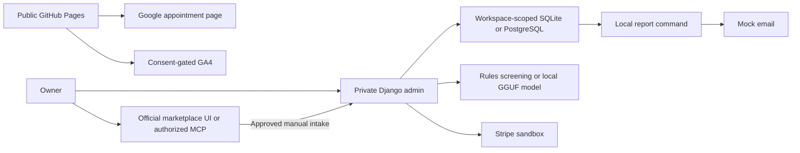

# Component boundaries · v0.5

- Public portfolio: Django templates, CSS, gettext, and a Python static exporter. GitHub Pages receives only dist. It links to the approved Google Calendar schedule and consent-gated GA4.
- Private Django: services stores inquiries and drafts, operations owns Stripe sandbox state and workspace identity, reporting owns scoped inputs, artifacts and delivery. Acquisition owns owner-entered opportunities, screening, listing references and marketplace receipts. Reuse Workspace as the organization boundary.
- Provider boundaries: marketplace discovery through approved owner-operated OAuth or manual input; no background scraping. Local screening first, optional loopback inference second. Payments, email and social publishing require independent gates.
- Financial boundary: direct Stripe invoices are separate from marketplace receipts. Reporting separates estimates, collections, costs and fees, with currency intact. No shared customer dashboard until membership and scope controls are implemented.

